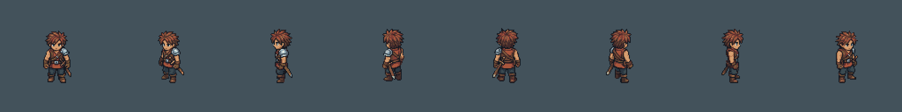
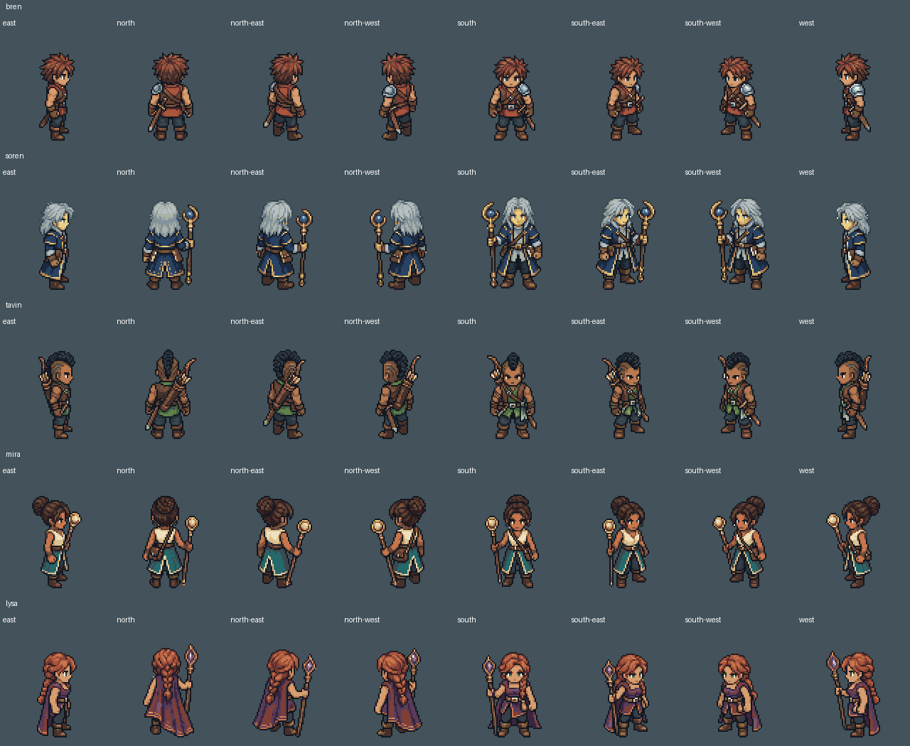
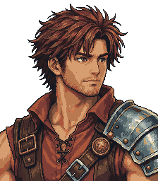
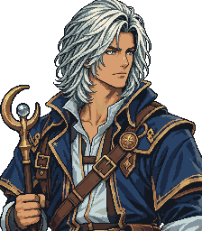

# PixelLab concept-led rebuild — progress checkpoint

This branch contains the new artwork and implementation in progress. **The new
PixelLab graphics are not yet integrated into the playable `index.html`.** The
live game remains the preceding tested release; this is not a finished visual
update or a new deployment.

The art direction comes from the original approved Google Drive character,
portrait, environment and UI concepts. Earlier generated game assets and the
superseded text-only character prototype are excluded from this rebuild. Private
reference images, upload receipts and credentials are not included here.

## Artwork available for review

- 37 distinct human characters, each with eight native directional views.
- Bren's new eight-direction walking cycle, plus additional generated animation
  clips for Bren and Soren. The detailed clip inventory is in
  [checkpoint.json](elyndor/assets/source/pixellab-v7/checkpoint.json).
- New transparent dialogue portraits for Bren and Soren.
- Fifteen sets of native 128-pixel material candidates and an ink/gold UI frame.
- A native-frame importer that preserves full poses, transparent margins and
  shared root alignment instead of guessing sprite-sheet crops.
- New UI styling and continuous-world layout changes awaiting integration.

All eight cast review boards are in
[the preview folder](elyndor/previews/pixellab-v7/).

## Validation and remaining work

The source-reference audit checked 55 accepted generation requests against the
approved Drive uploads and current-pass style anchors, with no references to
earlier generated game art. Included native PNGs were decoded and checked for
file integrity; new JavaScript modules passed syntax checks. These checks do not
establish that every generated pose is production-ready.

Remaining work includes the rest of the walking/idle cycles, party running and
combat, creature and object art, transparent speaker portraits, material
selection and seam checks, asset/UI integration, and full gameplay/performance
validation. The source changes in this checkpoint have not been validated as a
complete playable PixelLab build.
