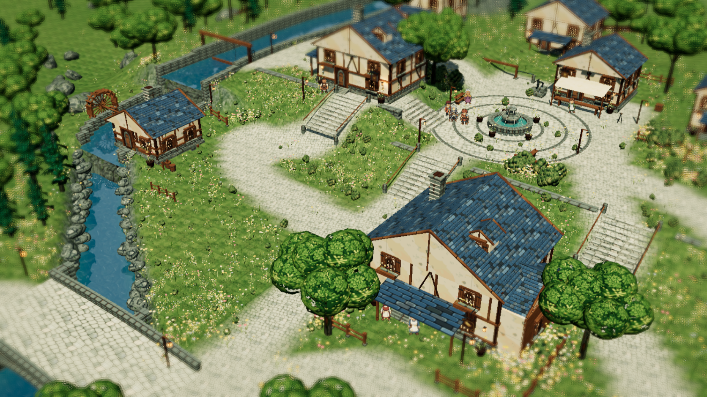

# The Last Light of Elyndor

[Play in your browser](https://jumin12.github.io/ember-tide/)

An original browser RPG with native PixelLab characters in a connected 3D landscape. Brookstead is rebuilt around an arched river bridge, a watermill and cascades, three terrain terraces, a fountain square, timber shops and planted gardens. Residents follow individual work routes, and the world moves continuously through dawn, daylight, dusk and night.

The complete playable regional arc includes exploration, seven story encounters, timed attack chains, abilities, two character ascensions, equipment, healing, shops, four Light restorations, journals and local saves.

Download `index.html` and open it directly to play offline. All required artwork and runtime code are embedded in that one file.



## Controls

- WASD or arrow keys move; Shift runs. Click clear ground to walk there.
- E or right-click interacts; people and objects can also be clicked.
- M opens the map, I inventory, C party, J journal, Escape menus/back, F fullscreen.
- Click menu buttons, or use arrow keys and Enter. Tab also moves keyboard focus.
- In battle, press E or click during the gold timing window to chain an attack.
- Three manual saves and autosave are stored in your browser. Opening the game on a different origin uses separate browser storage.

## PixelLab integration

The playable release uses the new PixelLab cast, full eight-direction walking and idle cycles, separate party running cycles, combat poses, transparent detailed portraits, world surfaces, props and icons. Previous generated game artwork is excluded from the asset manifest.

Buildings and individual trees cut away when they obscure the party. Physical shadows remain intact. Raised water pools have separate reflection planes, and sprite lighting responds to environmental shadows. Four-edge diorama blur preserves the focal center and interface.

See [asset notes](ASSET_NOTES.md), [build details](PIXELLAB_REBUILD.md) and `release.json` for provenance, scope and validation. This is a playable 3D reconstruction of the supplied concepts; it is not a pasted background or a pixel-for-pixel reproduction.

## Build

Install Python with Pillow and NumPy, then run:

```powershell
python elyndor/tools/build.py --final
```

The build reads only the committed native PixelLab manifest and sources. Generation accounts, private reference documents and network access are unnecessary for rebuilding or playing. Hardware-accelerated WebGL is recommended; software rendering remains substantially slower.
