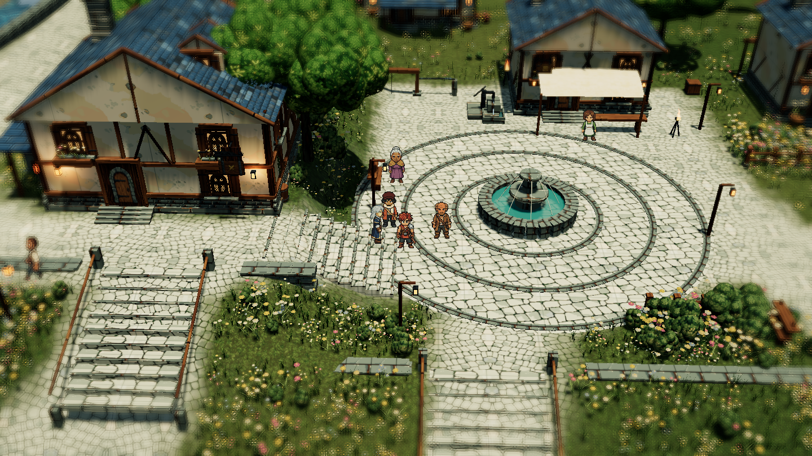

# The Last Light of Elyndor

[Play in your browser](https://jumin12.github.io/ember-tide/)

An original browser RPG with native PixelLab sprites in a lit 3D diorama. Explore a miniature overworld and enter 14 settlements, ruins, trails and secluded Light clearings. Eight cutaway interiors include inns, provision shops, the council chamber and royal archives.

Brookstead is a terraced river town with an arched bridge, watermill, cascades, gardens, fountain square and individual residents at work. The sluice holds a raised reservoir; opening it releases the stored water, and repairing the pump restores the town supply. Trees and buildings cut away individually when they obscure the party.

The playable regional story includes 45 progression steps, six encounters, timed three-hit attack chains, ten normal abilities, four Ascended counterparts, equipment, healing, shops, journals, four Light restorations and local saves. It ends at the northern assignment leading into the next region.

Battles use a traditional side view, with restrained cinematic spell shots, pooled textured 3D effects, and two post-battle pages showing rewards and actual character growth. Recorded ElevenLabs dialogue and battle calls are embedded: 244 clips across 12 cast roles. No account or API connection is needed to play.

Natural time, drifting clouds and projected cloud shadows persist across locations. Automatic weather includes clear skies, cloud, rain, thunder and regional snowfall. Dense grass, flowers and trees respond to wind and movement; foliage and shadows cover the camera's visible ground. Four-edge focus blur preserves the party and interface.

Download `index.html` and open it directly to play offline. Artwork, voices and runtime code are embedded in this one file.

## Controls

- WASD or arrows run; click clear ground to run there. Walking is reserved for cutscenes and NPC routines.
- E or right-click interacts. At a marked exit, E enters the overworld; at a landmark, E enters its location.
- M opens the atlas, I inventory, C party, J journal, Escape menus/back, F fullscreen.
- Click buttons or use arrows, Tab and Enter. Scroll adjusts zoom while preserving the fixed camera angle.
- In battle, press E or click in the gold timing window on each consecutive attack.
- Enter or Space advances battle results and growth; rewards apply once on returning to exploration.
- Three manual records and autosave use browser storage. Different website origins keep separate saves.

## Art and build

The selected cast, portraits, surfaces, props and effects use PixelLab. Whole native frames are registered to consistent baselines and packed losslessly. Earlier generated game artwork is excluded from the runtime manifest. This is an authored 3D interpretation of the supplied concepts, with original characters and interface.

Loading screens use actual game captures. Location transitions prepare geometry and shader variants behind the loader. Program retention is bounded; geometry is released when a location unloads. Recruitment retains existing actors and follower state.

Install Python with Pillow and NumPy, then run `python elyndor/tools/build.py --final`. Run `python elyndor/tools/regression-v12.py` for the sequential native Chrome/Playwright checks. The audio audit additionally uses `imageio-ffmpeg`; existing recorded Ogg files require no API access to build.

For optional voice regeneration, `voice_credentials.py` reads `ELEVENLABS_API_KEY` or the local Windows Credential Manager entry `Codex/ElevenLabs`. Credentials are never embedded or published. Generate missing catalog lines with `generate-voices-v12.py`, then encode with `compress-voices-v12.py`.

See [asset notes](ASSET_NOTES.md), [build details](PIXELLAB_REBUILD.md) and `release.json` for provenance and measured validation. Performance results describe the tested device; software WebGL and lower-powered machines remain slower.
